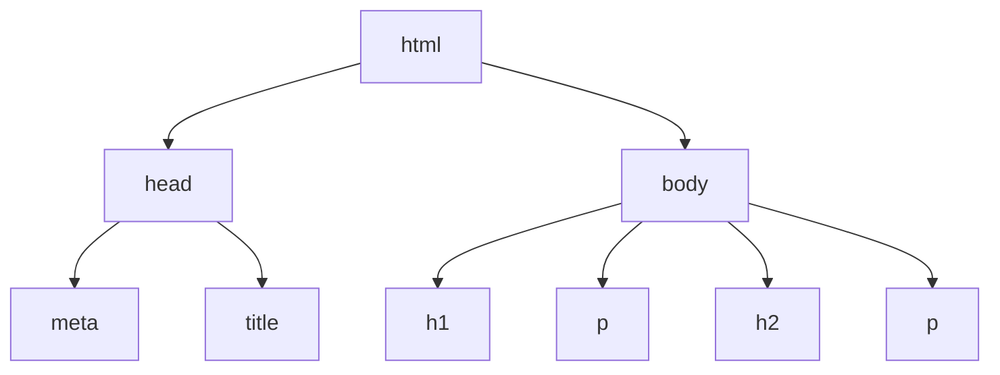

# Day 1 — HTML Fundamentals and Document Structure

> **Today’s goal:** Understand *why* HTML exists, what tags and elements mean, and how to build and explain a basic web page from scratch. You do **not** need CSS or JavaScript for this lesson.


## 1. Learning Overview

| Item | Details |
| --- | --- |
| Level | Absolute beginner |
| Suggested time | 2–3 hours, including practice; adjust to the learner |
| Prerequisites | Create, save, and open files; use a text editor and a web browser |
| Tools | Any plain-text/code editor (for example, VS Code) and a modern web browser |
| Main output | A working `.html` page written and explained independently |

By the end of Day 1, you should be able to:

- Explain what HTML does and how it differs from CSS and JavaScript.
- Identify opening tags, closing tags, elements, content, and simple attributes.
- Explain the purpose of `<!DOCTYPE html>`, `<html>`, `<head>`, `<title>`, and `<body>`.
- Recognize parent–child relationships and correctly nest elements.
- Create, open, modify, and inspect a basic HTML document in your browser.

**Scope boundary:** Forms, advanced attributes, CSS styling, JavaScript behavior, and full semantic page layouts are later topics. We will use only a few common content elements today.

## 2. Why Are We Learning HTML?

### The problem before the solution

Imagine receiving a document that contains only this plain text:

```text
Community Clinic
Welcome to our information page.
Opening Hours
Monday to Friday: 9 AM to 5 PM.
```

A person can guess that the first and third lines are headings. But the text itself does not explicitly tell software which pieces are headings or paragraphs. Without meaningful markup, page structure is ambiguous to browsers and assistive technologies.

**HTML solves this by describing what the content *is*.** For example, it can identify a main heading, a section heading, and a paragraph. Browsers use that structure to present the page, and other tools can use it to interpret the content.

### HTML, CSS, and JavaScript: different jobs

| Technology | Main responsibility | Simple example |
| --- | --- | --- |
| **HTML** | Structure and meaning of content | “This is the page heading.” |
| **CSS** | Presentation and layout | “Make that heading blue and center it.” |
| **JavaScript** | Behavior and interaction | “Show a message when a button is clicked.” |

HTML is a **markup language**, not a general-purpose programming language. It is the foundation for many web pages, but it does not by itself provide application logic.

## 3. Prerequisites

You should be able to create a new folder, make a text file, save it with the `.html` extension, and open it in a browser. If you do not yet know how, follow the steps in [Section 7](#7-practical-code-example).

There are no prior lessons in this repository. You do **not** need to learn JavaScript before this lesson.

## 4. Core Concepts: Tags, Elements, and Attributes

### 4.1 What is a tag?

A **tag** is part of the HTML syntax, written between angle brackets. Most HTML elements have a start tag and an end tag.

```html
<p>This is a paragraph.</p>
```

- `<p>` is the **start (opening) tag**.
- `This is a paragraph.` is the text **content**.
- `</p>` is the **end (closing) tag**.
- The entire construction is a **paragraph element**.

A useful distinction: a *tag* is the markup used to identify an element; an *element* is the item represented in the HTML document.

### 4.2 What is an attribute?

An **attribute** supplies extra information on an element’s start tag.

```html
<html lang="en">
```

Here, `lang` is an attribute and `"en"` is its value. It declares the document’s main language as English, which helps tools such as screen readers select the appropriate pronunciation rules.

You will learn many more attributes in later lessons. Today, recognize their basic `name="value"` form.

### 4.3 Do all HTML elements need a closing tag?

No. Some elements are **void elements**: they cannot have child content and do not use an end tag. One example used in this lesson is:

```html
<meta charset="UTF-8">
```

Other elements, such as `<p>` and `<title>`, are not void elements. For beginner code, explicitly write their end tags even when HTML has special rules allowing certain tags to be omitted.

### 4.4 What does nesting mean?

HTML elements can contain other elements. The outside element is called the **parent**; a nested element is its **child**.

```html
<body>
  <h1>Welcome</h1>
  <p>This is a short introduction.</p>
</body>
```

Here, `body` is the parent of the `h1` and `p` elements. They are siblings of one another.

**Good practice:** Close nested elements in the reverse order from which you opened them. Do not overlap their tags.

```html
<!-- Correct nesting -->
<p>This is <strong>important</strong> information.</p>

<!-- Incorrect overlapping tags: do not copy this pattern -->
<p>This is <strong>important information.</p></strong>
```

`<strong>` marks text as having strong importance. It is used here only to illustrate nesting.

## 5. Real-Life Analogy: A Printed Book

Think of a book:

- Its **cover title** helps readers identify the book, similar to how `<title>` identifies a browser tab.
- Its **chapter headings** organize the material, similar to HTML heading elements such as `<h1>` and `<h2>`.
- Its **paragraphs** contain actual reading content, similar to `<p>` elements.

A page with only undifferentiated text would be harder to navigate. HTML adds meaningful structure so software can distinguish these roles.

**Where the analogy stops:** HTML is not literally a book layout system. Browsers process HTML into a document model and apply rendering rules; CSS is typically responsible for detailed visual design. Also, the HTML `<head>` is *not* the visible header at the top of the page.

## 6. Technical Explanation: An HTML Document

A basic HTML file is a text document containing a document type declaration and HTML elements.

### 6.1 `<!DOCTYPE html>` — document type declaration

```html
<!DOCTYPE html>
```

The doctype appears before the root HTML element. In modern HTML, it primarily tells the browser to use **standards mode** rather than a legacy compatibility rendering mode (commonly called *quirks mode*). It is **not** an ordinary HTML element and does not create a visible item on the page.

**Accuracy note:** Modern HTML follows an evolving **HTML Living Standard**. The doctype is not a version selector that freezes a document to a numbered “HTML5” release.

### 6.2 `<html>` — root element

```html
<html lang="en">
  <!-- The head and body belong here. -->
</html>
```

The `html` element is the root HTML element of the document. Its two principal child elements are `head` and `body`. A `lang` attribute is recommended so the document declares its primary language.

### 6.3 `<head>` — information *about* the document

```html
<head>
  <meta charset="UTF-8">
  <meta name="viewport" content="width=device-width, initial-scale=1.0">
  <title>My First Webpage</title>
</head>
```

- **`<head>`:** Holds metadata and links to certain page resources; it is not the visible page heading.
- **`<meta charset="UTF-8">`:** Declares the text encoding; UTF-8 supports characters from many writing systems.
- **`<meta name="viewport" ...>`:** Gives browsers on mobile devices information about the page’s viewport and initial scale. We will discuss responsive layouts in CSS lessons.
- **`<title>`:** Defines the document title, commonly shown on the browser tab. This is different from a heading displayed *inside* the page.

### 6.4 `<body>` — document content

```html
<body>
  <h1>Hello, World!</h1>
  <p>This is my first HTML page.</p>
</body>
```

- `<h1>` represents a top-level heading.
- `<p>` represents a paragraph.
- `<h2>` represents a heading for a subsection. Use headings to describe structure, not merely to make text appear large.

The `body` holds page content, but not everything placed there is automatically visible; some elements are non-visual, and some content may be hidden.


### 6.5 Simplified element tree




The diagram illustrates **element parent–child relationships**. It intentionally omits text nodes and other details. `<!DOCTYPE html>` is not shown as an element in this tree.

## 7. Practical Code Example

### Scenario: A simple clinic information page

We want a page that names a fictional clinic, gives a welcome message, and displays example opening hours. This is a **generic learning example**, not a statement of any real company or clinic requirement.

### Step 1 — Create the file

1. Create a folder named `html-day-01` anywhere you keep your exercises.
2. Open it with your code editor.
3. Create a file named `index.html`.
4. Type the following HTML (typing it yourself is more useful than simply copying it).

### Step 2 — Write the complete document

```html
<!DOCTYPE html>
<html lang="en">
  <head>
    <meta charset="UTF-8">
    <meta name="viewport" content="width=device-width, initial-scale=1.0">
    <title>Community Clinic | Information</title>
  </head>
  <body>
    <h1>Community Clinic</h1>
    <p>Welcome to our information page.</p>

    <h2>Opening Hours</h2>
    <p>Monday to Friday: 9:00 AM to 5:00 PM.</p>
  </body>
</html>
```

### Step 3 — Open the page

Save the file, then open `index.html` in Chrome, Firefox, Edge, or another modern browser. For this static page, a development server is **not required**.

### Expected behavior

- The **browser tab title** reads `Community Clinic | Information`.
- The **page content** includes a large “Community Clinic” heading, a welcome paragraph, the “Opening Hours” heading, and a second paragraph.
- The browser supplies basic default visual styling even though we have not written CSS.

### Step 4 — Understand the execution flow

1. The browser opens and reads the HTML file.
2. Its HTML parser interprets the markup and constructs a document tree (the **DOM**, or Document Object Model).
3. The browser uses metadata such as the title and applies its normal rendering rules to page content.
4. It presents the page on screen.

Do not confuse the **source file**, the **DOM tree**, and the **visible page**; these are related but different things.

### Step 5 — Observe how a small change behaves

- Change only the `<title>` text, save, and refresh. Observe what changes in the tab.
- Change only the `<h1>` text, save, and refresh. Observe what changes inside the page.
- Explain why these changes affect different places.

That last explanation is more important than just getting the page to display.

## 8. Real-World Engineering Application

Whether a team builds a blog, an admin dashboard, a student management system, or a clinic scheduling interface, the browser still depends on HTML elements to represent the page’s content and meaning.

Frameworks such as Angular may generate and update HTML elements dynamically, but learning HTML helps developers understand **what those elements represent**, how headings and content should be organized, and why correct nesting matters.

A useful mental model: HTML defines a page’s content structure; a frontend framework manages how a user interface is composed and updated. Knowing HTML remains essential even when you later use a framework.

## 9. Hands-On Assignments

**Important:** Work independently. The lesson deliberately does not provide completed assignment solutions. Submit the `.html` files plus a short explanation of your choices.

### Level 1 — Foundation: My First Page

**Objective:** Create a valid HTML document without copying the main example unchanged.

**Prerequisites:** Sections 4–7 of this lesson.

**Requirements:**

1. Create a file named `about-me.html`.
2. Include the doctype, an `html` root with the appropriate language, a `head`, and a `body`.
3. Add a relevant `title`, UTF-8 character encoding, and viewport metadata.
4. Inside the body, show your page’s main heading and **at least two paragraphs**.
5. Keep the HTML properly nested and indented.

**Expected output:** A browser tab title and visible heading/paragraphs that are different from each other.

**Acceptance criteria:**

- [ ] I can open the page locally without errors preventing the content from appearing.
- [ ] The tab title matches the title I chose.
- [ ] The body contains a main heading and at least two paragraphs.
- [ ] The doctype and essential structural elements are present.
- [ ] I can explain the purpose of each required element.

### Level 2 — Practical Application: Help Desk Information Page

**Objective:** Organize realistic content into meaningful sections.

**Prerequisites:** Level 1 plus the basic distinction between `<h1>` and `<h2>`.

**Requirements:**

1. Create `help-desk.html` for a **fictional** college or community help desk.
2. Give it a meaningful browser-tab title.
3. Include one main heading, **two subsection headings**, and at least three short paragraphs.
4. Make each paragraph appropriate to the heading under which it appears.
5. Use no CSS and no JavaScript.

**Expected output:** A page whose information is grouped in a clear hierarchy, even with the browser’s default styling.

**Acceptance criteria:**

- [ ] A reader can identify the page topic and the two sections.
- [ ] The heading order reflects the content hierarchy.
- [ ] The tab title is not confused with the page heading.
- [ ] The page renders with correctly nested HTML.

### Level 3 — Engineering Challenge: Diagnose Broken Markup

**Objective:** Spot common document structure errors before relying on the browser to repair them.

**Task:** Inspect the intentionally incorrect code below and create a corrected file called `fixed-notice.html`.

```html
<html>
  <head>
    <title>Notice</title>
  <body>
    <h1>Important Notice</h2>
    <p>Please read the information carefully.
  </body>
</html>
```

**Requirements:** Find the incorrect or missing pieces, add the document-level information taught today, correct the mismatched or unclosed tags, and explain **why the browser may still show something even when the markup is invalid**.

**Acceptance criteria:**

- [ ] My corrected document includes a valid modern HTML doctype.
- [ ] The root document language is declared.
- [ ] The head/body structure is clear and well formed.
- [ ] The heading and paragraph markup have the correct end tags.
- [ ] I can describe one example of browser error recovery.

**Optional stretch challenge:** Use your browser’s developer tools to inspect the document’s element tree and compare it with your original file. Notice how the parsed DOM may differ when markup is invalid.

### Submission guidance

Provide:

- The `.html` file(s) for the assigned level(s).
- A browser screenshot showing the expected visible output, if your mentor requests one.
- A short written answer to: “What does HTML structure, and why are `<title>` and `<h1>` not interchangeable?”

## 10. Common Mistakes and Debugging

### Mistake A — Forgetting an end tag

```html
<!-- Incorrect beginner practice -->
<h1>Welcome
<p>This is a paragraph.</p>
```

```html
<!-- Correct -->
<h1>Welcome</h1>
<p>This is a paragraph.</p>
```

Even when browsers recover from malformed markup, explicitly closing normal elements makes documents easier to understand and maintain.

### Mistake B — Mixing up page title and visible heading

```html
<head>
  <title>Student Portal</title>
</head>
<body>
  <h1>Student Dashboard</h1>
</body>
```

`Student Portal` is the document title used by the browser tab. `Student Dashboard` is a heading in the page content.

### Mistake C — Thinking `<head>` means the top of the visible page

The HTML `head` stores document metadata. A visible heading belongs in the `body`; later lessons introduce elements for more complete page structure.

### Mistake D — Saving the wrong file type

If the file is named `index.html.txt`, the operating system may treat it as plain text instead of the HTML document you intended. Check the **actual file extension**.

### Mistake E — Using appearance to choose heading tags

Choose `<h1>` and `<h2>` because of their **meaning in the content hierarchy**, not because one is larger than the other. Visual styling is a separate CSS concern.

## 11. Knowledge Check

Answer before looking back at the lesson.

1. **Concept:** What problem does HTML solve that plain unstructured text does not?
2. **Concept:** How does an HTML *element* differ from a *tag*?
3. **Concept:** Why do we include `<!DOCTYPE html>` in a modern HTML document?
4. **Concept:** Why are `<head>` and `<body>` separate?
5. **Predict:** If you edit `<title>` but not `<h1>`, what should change when you refresh the page?
6. **Debug:** What is structurally wrong with `<h1>Welcome</h2>`?
7. **Scenario:** You want to create a subsection under a page’s main heading. Which heading element would typically be appropriate, and why?
8. **Reasoning:** Does a page displaying text in a browser prove that its HTML is valid? Explain.

## 12. Interview and Engineering Discussion

A mentor may ask:

- **“Explain HTML to someone who has never built a webpage.”** A strong response describes HTML as structured, meaningful markup, rather than merely “code that makes text appear.”
- **“Compare HTML, CSS, and JavaScript.”** A strong response distinguishes structure/meaning, styling/layout, and behavior/interactivity.
- **“Walk me through your page from doctype to body.”** A strong response identifies the purpose and relationship of the main document pieces.
- **“Why might malformed HTML still look okay?”** A strong response recognizes that browsers perform error recovery but that this should not replace writing clear, correct markup.

## 13. Quick Revision Notes

- **HTML:** HyperText Markup Language; represents web content and its structure.
- **Tag:** Markup syntax such as `<p>` or `</p>`.
- **Element:** The document item represented by markup, often with a start tag, content, and end tag.
- **Attribute:** Additional information in a start tag, such as `lang="en"`.
- **Void element:** An element such as `meta` that has no closing tag or child content.
- **Doctype:** The declaration that triggers standards-mode rendering in modern HTML.
- **`html`:** The root HTML element.
- **`head`:** Document metadata, including `title`.
- **`body`:** Page content.
- **Nesting:** A child element belongs inside its parent element.
- **DOM:** The document tree constructed by the browser from parsed markup.

## 14. Learning Resources

### Official documentation — checked 17 October 2026

1. [MDN — Basic HTML syntax](https://developer.mozilla.org/en-US/docs/Learn_web_development/Core/Structuring_content/Basic_HTML_syntax): Best companion during **Day 1**, especially for tags, elements, document structure, and basic exercises.
2. [MDN — What is in the head?](https://developer.mozilla.org/en-US/docs/Learn_web_development/Core/Structuring_content/Webpage_metadata): Read **after Section 6** to reinforce metadata, document title, and character encoding. Some material goes beyond Day 1.
3. [WHATWG — HTML Living Standard, syntax](https://html.spec.whatwg.org/multipage/syntax.html): A **technical reference**, not required beginner reading. Use when checking precise syntax or doctype behavior.

### User-supplied visual reference

- [HTML document tree image](https://d3pdqc0wehtytt.cloudfront.net/media/reading-images/b0043a01-caef-4309-b958-9e8e06833365.png): The link was reachable when checked. It illustrates a simplified `html`/`head`/`body` element hierarchy. **Image reuse permissions were not checked**; the original image should not be copied into a public repository without permission. The Mermaid diagram above is a standalone alternative.


## 15. Completion Checklist

- [ ] I can explain why HTML exists and how it differs from CSS and JavaScript.
- [ ] I can identify tags, elements, content, and attributes in sample code.
- [ ] I understand why some elements, such as `meta`, do not have end tags.
- [ ] I can explain `<!DOCTYPE html>`, `html`, `head`, `title`, and `body`.
- [ ] I can explain parent, child, and sibling elements.
- [ ] I can make a new `.html` page from scratch and open it in a browser.
- [ ] I completed the assigned practical exercise(s).
- [ ] I can distinguish browser-tab title from page heading.
- [ ] I answered the knowledge-check questions and addressed any mentor feedback.

**Readiness checkpoint:** You are ready for the next HTML lesson when you can produce a valid small document **without copying the starter example** and explain what each structural piece does. If you cannot yet do that, revisit the relevant sections and repeat Level 1.

## 16. What’s Next?

**Suggested next area (not yet published): HTML content and meaningful structure.** Learn to represent different kinds of page content — headings, paragraphs, lists, links, and images — and begin understanding why semantics matter. The exact next lesson will be agreed and added to the [HTML module index](README.md) when its scope is confirmed.


